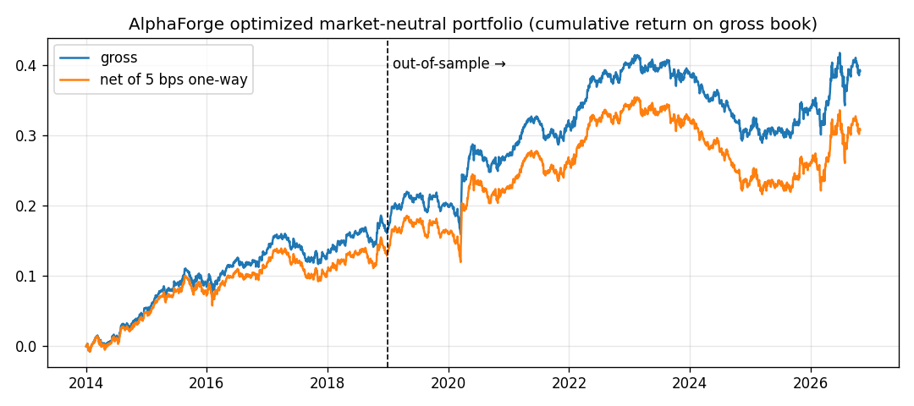

# AlphaForge — Market-Neutral Equity Alpha Research

A research pipeline for building cross-sectional equity alphas on US large caps. It starts from free public data (Yahoo Finance prices, SEC EDGAR XBRL fundamentals), then defines, neutralizes and scores alphas. Alphas are selected and combined in a purged walk-forward procedure, and the combined forecast feeds a constrained daily `cvxpy` optimizer.

All selection and tuning use the **in-sample period (2011-07 to 2018-12)**. The **out-of-sample period (2019-01 to 2026-10)** is reported once with the configuration frozen. Every number below is generated by the scripts in this repo.

## Results (out-of-sample 2019-01 → 2026-10, 1,966 trading days)

| Optimized portfolio | Gross | Net of 5 bps one-way |
|---|---|---|
| Sharpe ratio (annualized) | **0.56** | **0.43** |
| Annual return on gross book | 2.9% | 2.2% |
| Annual volatility | 5.1% | 5.1% |
| Max drawdown | −12.5% | −13.8% |
| Correlation to SPY (daily) | 0.12 | 0.12 |

In-sample (2014–2018) the same configuration had a net Sharpe of 0.83. The out-of-sample decay from 0.83 to 0.43 is the honest cost of selection. Other portfolio statistics: average daily one-way turnover was 5.3% of book, gross exposure was 1.0×, the book held about 127 names, and mean |beta exposure| was 0.008. Year by year (`results/portfolio_yearly.csv`), 2024 was a large loss (−8.9%, Sharpe −2.4) and 2023 was slightly negative.



### Combination baselines (dollar-neutral, fully rebalanced daily, no optimizer)

| OOS | Rank IC | Gross Sharpe | Net Sharpe | Daily turnover |
|---|---|---|---|---|
| Walk-forward OLS (selected on IS) | 0.36% | 0.24 | −0.17 | 18.8% |
| Equal-weight of selected alphas | 1.11% | 0.29 | −0.21 | 18.3% |

Without turnover control, costs consume the entire edge. Most of the net Sharpe comes from the optimizer's turnover cap, risk model and neutrality constraints, which cut turnover by about 3.5×. Out of sample the equal-weight composite had a *higher* IC than the regression combiner, although the regression won in-sample. Regression weights over 8 correlated, noisy signals do not generalize better than a simple average.

## Pipeline

```
scripts/download_data.py          S&P 500 constituents (Wikipedia) + daily OHLCV 2010–2026 (yfinance)
scripts/download_fundamentals.py  SEC EDGAR companyfacts: EPS, net income, revenue, CFO, equity, assets, shares
scripts/01_alpha_research.py      compute 49 alphas → neutralize → IS/OOS scorecard
scripts/02_combine_and_portfolio.py  select → walk-forward combine → optimize → report
scripts/03_plots.py               charts
```

### 1. Data, point-in-time (`alphaforge/data.py`, `alphaforge/fundamentals.py`)
- 503 current S&P 500 names. A stock only enters the universe after its S&P 500 *date added*, after 252 days of history, and while its price is above $5. The universe grows from about 270 names in 2011 to about 490 in 2026.
- Fundamentals: each fiscal period uses the **first-filed** value, so later restatements are ignored. A value becomes usable on the trading day *after* its SEC filing date. Q2–Q4 flows are derived from year-to-date cumulatives (Q4 = FY − 9M). TTM and YoY values require consecutive quarters.
- Trading is at **delay 1**: a signal at close *t* is traded at close *t+1* and earns close *t+1* → *t+2*.

### 2. Alpha library (`alphaforge/alphas.py`): 49 alphas in 12 families
Reversal (raw and beta-hedged residual, 1–21 days), momentum (12-1, 6-1, residual momentum, 52-week high, MA cross), risk (low vol, idiosyncratic vol, MAX, skewness), volume (volume-shock reversal, volume trend, price–volume correlation), liquidity (Amihud, high–low range), intraday (overnight vs. intraday reversal), earnings (SUE on EPS, revenue and net income; post-earnings announcement drift), value (E/P, B/P, S/P, CFO/P), quality (ROE, ROA, accruals, CFO/assets), investment, growth, and size.

### 3. Neutralization and evaluation (`neutralize.py`, `evaluate.py`)
- A daily cross-sectional regression on 11 GICS sector dummies plus 252-day market beta strips out the residual. The result is z-scored and clipped at ±3.
- Scorecard (`results/alpha_scorecard.csv`): daily rank IC, ICIR, **Newey–West t-stat**, IC decay over 1/2/5/10/20-day horizons, long–short Sharpe (gross and net) and turnover, reported separately for IS and OOS.

### 4. Selection and walk-forward combination (`combine.py`)
- Selection uses IS data only. Alphas must have |NW t| ≥ 2 (19 of 49 pass). A greedy filter then admits an alpha only if its long–short PnL correlation with every already-admitted alpha is below 0.5. This leaves **8 alphas** (mean |corr| 0.13): `sue_eps, mom_252_21, size, max_21d, sales_growth, cfo_to_assets, earn_ann_ret, ma_dist_20d`.
- Combiners are refit monthly on a trailing window: pooled ridge/OLS regression on h-day forward returns, IC-weighting, or equal weight. Training labels are **purged** (h + delay days) and embargoed (5 days), so no label overlaps the forecast month. A 37-configuration grid over combiner × horizon × window × λ was searched on IS only (`results/combo_tuning_is.csv`). The winner was OLS, 5-day horizon, 756-day window.
- The forecast is converted to expected returns Grinold-style: α = IC × σ_idio × z.

### 5. Portfolio construction (`portfolio.py`)
The problem is solved daily with CLARABEL. It is compiled once and re-solved through DPP parameters, at about 25 ms per day for 503 names.

```
max  α'w − γ (‖Lᵀw‖² + Σ σᵢ² wᵢ²)
s.t. Σw = 0,  ‖w‖₁ ≤ 1,  |βᵀw| ≤ 0.01,  |Sᵀw| ≤ 0.01 (per sector),
     |wᵢ| ≤ 2%,  ‖w − w_prev‖₁ ≤ 5%   (w_prev drifted by realised returns)
```
L is a 10-factor PCA risk model refit monthly on 252 days of returns. γ and the turnover cap were chosen on IS (`results/optimizer_tuning_is.csv`). Earlier versions are kept in `results/v1_*`, `v2_*` and `v3_*`. With a linear cost penalty instead of a cap, the optimizer never invested the book. With only a diagonal risk model, out-of-sample volatility tripled in 2026.

## Tests
```
pytest -q        # 45 tests, synthetic data, no download needed
```
- **Look-ahead tests:** every price/volume alpha must give identical values when all data after *t* is removed (30 parametrized cases).
- Neutralized signals are orthogonal to sectors and beta.
- Rank IC matches `scipy.stats.spearmanr`.
- Q4 derivation is correct and the first filing wins over restatements.
- Fundamentals are not usable on the filing day itself.
- **Purge test:** perturbing labels inside the purge gap leaves forecasts unchanged.
- Ridge recovers a planted coefficient.
- Correlation filter drops duplicate alphas.
- All optimizer constraints hold.

## Limitations (read before trusting the numbers)
- **Survivorship bias:** the universe is today's S&P 500 constituents. Stocks removed from the index (bankruptcies, acquisitions, demotions) are missing. Requiring a stock to have been added already prevents look-ahead on additions, but losers that left are absent. Free data makes this hard to fix. It likely flatters `size`, momentum and low-risk alphas.
- Costs are a flat 5 bps one-way. A fuller spread + square-root impact + borrow-cost simulation of the same weights is done in [QuantSim](https://github.com/piyushr27/QuantSim).
- Shares outstanding come from 10-K/10-Q cover pages, so market cap can lag corporate actions by up to a quarter.

## Setup
```
uv venv .venv && uv pip install -r requirements.txt
python scripts/download_data.py && python scripts/download_fundamentals.py   # ~10 min, ~2 GB EDGAR cache
python scripts/01_alpha_research.py && python scripts/02_combine_and_portfolio.py && python scripts/03_plots.py
```
